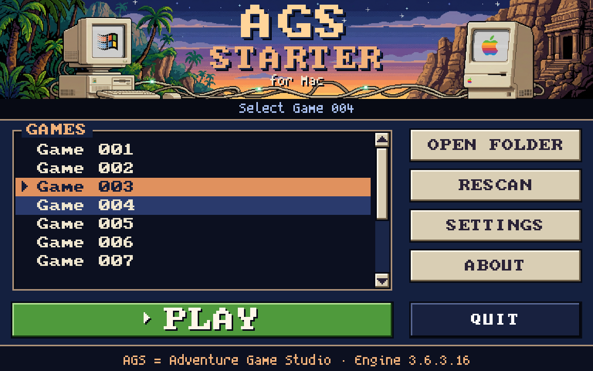
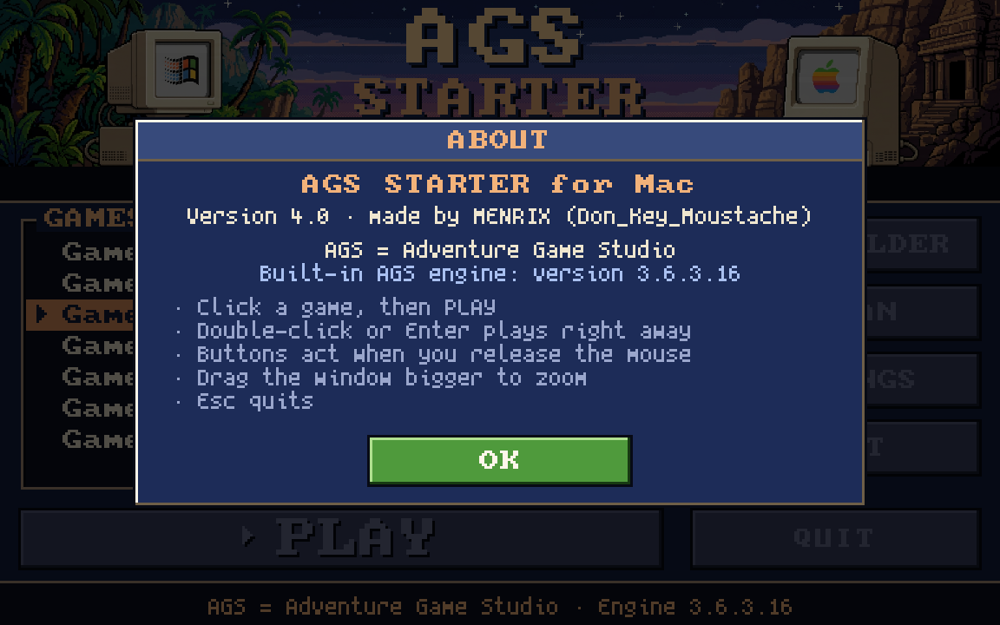
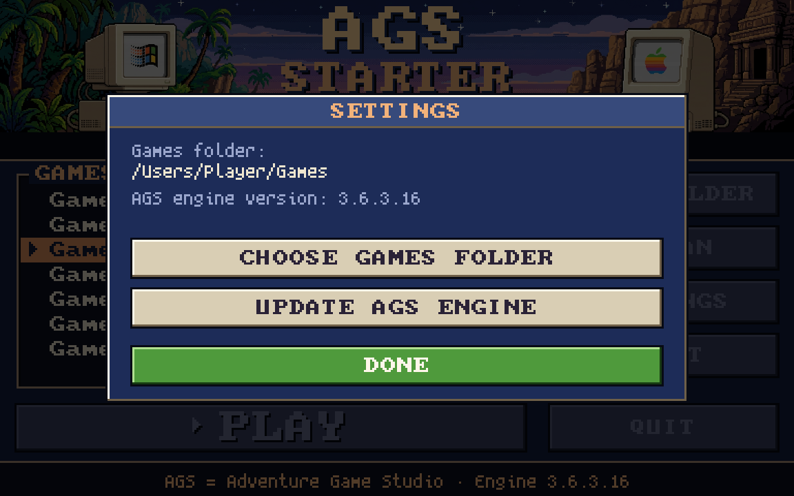
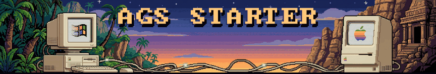

# AGS Starter for Mac

A retro launcher for **AGS games** (Adventure Game Studio) on macOS.
Many point-and-click adventures are only sold for Windows — AGS Starter plays them natively on your Mac
with the built-in AGS engine. No Windows, no emulator.



## Features

- 🎮 Built-in AGS engine (3.6.3) – plays AGS games made with AGS 3.6.2 and older
- 📂 Game list from your own games folder (one subfolder per game)
- 🖱️ Retro point-and-click interface: select a game, then **PLAY** – buttons act on release
- 🔍 Pixel-perfect zoom: make the window bigger and the whole screen scales up, like ScummVM
- 🌴 Animated pixel-art header (data pulses travelling from PC to Mac, twinkling stars, CRT flicker)
- 🔄 Update the AGS engine any time from **SETTINGS**

| About | Settings |
|---|---|
|  |  |



## Install

1. Download `AGS_Starter.zip` from **Releases** (or **Actions → latest run → Artifacts**) and unzip it.
2. Move **AGS Starter** into your Applications folder.
3. The app is not signed by Apple, so macOS blocks it the first time. Open Terminal and run
   (drag the app into the Terminal window instead of typing the path):
   ```
   xattr -cr "/Applications/AGS Starter.app"
   ```
4. Start the app and choose your games folder:
   ```
   Games/
     Game 001/   (game.ags, audio.vox, …)
     Game 002/
   ```
   Games bought on Steam/GOG for Windows work too – copy the game's folder (the one with the `.ags` file).

## Controls

| | |
|---|---|
| Click a game | select it |
| **PLAY**, double-click or Enter | play the selected game |
| OPEN FOLDER | show your games folder in Finder |
| RESCAN (F5) | look for new games |
| SETTINGS | choose games folder · update AGS engine |
| Arrow keys / mouse wheel | scroll · **Esc** quits |

Microphone prompt when a game starts? Choose *Don't Allow* – it is not needed.
Log file: `~/Library/Logs/AGS Starter.log`

## Build

The app is built automatically by GitHub Actions on a macOS runner (`.github/workflows/build.yml`).
Code: `src/main.c` (C + SDL2) · header image: `mac/header.bmp` · build script: `mac/build.sh`.
Pushing a tag `v…` publishes a release.

## Credits & license

Made by **MENRIX (Don_Key_Moustache)** – released under the [MIT License](LICENSE).

Built with the [AGS engine](https://github.com/adventuregamestudio/ags) (Artistic License 2.0), SDL2 (zlib),
font8x8 (public domain) and Spleen 5x8 (BSD 2-Clause). Details: [THIRD-PARTY-NOTICES.md](THIRD-PARTY-NOTICES.md).
